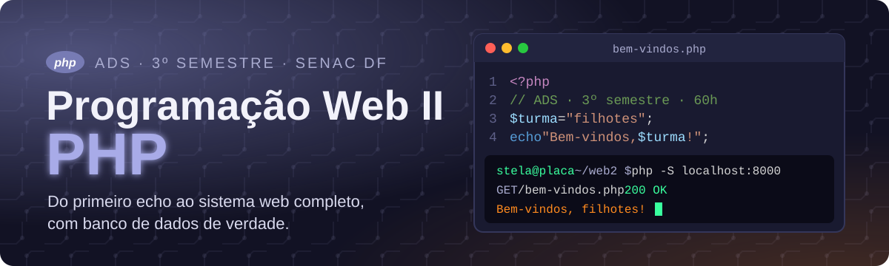

<p align="center">
  
</p>

<p align="center">
  
  
  
  
</p>

<p align="center">
  <b><a href="https://maristelaoliveira.github.io/prog-web-php/">🌐 Abrir o site da disciplina</a></b>
  &nbsp;·&nbsp;
  <b><a href="https://maristelaoliveira.github.io/prog-web-php/curso/">🐘 Abrir o Curso Básico de PHP</a></b>
  &nbsp;·&nbsp;
  <b><a href="https://maristelaoliveira.github.io/prog-web-php/aulas/aula-09.html">📚 Ir para a aula 9</a></b>
</p>

---

## `<?php echo "Prazer!"; ?>`

Prazer, eu sou a **Profa. Maristela**, ou só **Stela**! 👋

Boas-vindas à **Linguagem de Programação para Web II**, a nossa Web II com PHP, do curso de **Análise e Desenvolvimento de Sistemas** da Faculdade de Tecnologia e Inovação Senac DF (3º semestre, 60 horas, 19 encontros).

Este repositório é o **site da disciplina**: o lugar onde ficam as aulas, os tutoriais, o Curso Básico de PHP e tudo o que a gente usa no semestre. Nada de slides: aqui a aula é o próprio site.

Aqui a página deixa de ser vitrine e começa a pensar. Olha o servidor embutido do PHP trabalhando:

```text
stela@placa ~/web2 $ php -S localhost:8000

  GET  /bem-vindos.php     200  → "Bem-vindos, filhotes!"
  POST /cadastro.php       200  → cliente guardado no banco 💾
  GET  /cadastro.php?busca=ana  → GET é cartão-postal: todo mundo lê o endereço
  GET  /tarefa-pronta.php  404  → esse arquivo ainda não existe 😅
```

> 🐘 Curiosidade: PHP queria dizer **Personal Home Page**. Hoje é **PHP: Hypertext Preprocessor**, um acrônimo que chama a si mesmo. Piada clássica de programador. E o mascote é um elefantinho azul, o elePHPant.

---

## 🧭 O que tem no site

| | Seção | Para que serve |
|:-:|---|---|
| 🔬 | **Raio-X do PHP** | Como o PHP trabalha nos bastidores, do pedido do navegador ao HTML pronto, com seis curiosidades. |
| 📜 | **Ementa e objetivos** | A ementa oficial e aonde a gente quer chegar. |
| 🧩 | **Conteúdo programático** | As oito unidades, do primeiro `echo` aos Web Services. |
| ⚙️ | **Como funciona** | A metodologia: explicação rápida, laboratório longo e um sistema web construído aos poucos. |
| 📚 | **Aulas** | Uma página por encontro, com problema, conceitos, tutorial passo a passo, estudo de caso e checklist. |
| 🐘 | **Curso Básico de PHP** | 11 módulos com explicação, exemplos, perguntas interativas e quiz, num terminal cheio de neon. |
| 📅 | **Próximas entregas** | Os prazos que vêm por aí, para ver de longe. |

---

## 🗺️ A trilha do semestre

Oito unidades, um sistema web completo no fim. Em PHP, fica assim:

```php
<?php
$trilha = [
    "Unidade 1 · introdução: ambiente, sintaxe e HTML com PHP",
    "Unidade 2 · variáveis, constantes e operadores",
    "Unidade 3 · decidir e repetir (if, match, for, foreach)",
    "Unidade 4 · funções",
    "Unidade 5 · classes e objetos",
    "Unidade 6 · PHP e MySQL: os dados param de sumir",
    "Unidade 7 · include e require: cada coisa no seu arquivo",
    "Unidade 8 · relatórios, gráficos e Web Services",
];

foreach ($trilha as $passo => $unidade) {
    echo ($passo + 1) . ". $unidade\n";
}
echo "🏁 Sistema web no ar!\n";
```

| Aula | Tema | |
|:-:|---|:-:|
| 09 | Cadastro de Clientes, parte I: do formulário ao banco de dados (validação, PDO e SQLite) | [abrir](https://maristelaoliveira.github.io/prog-web-php/aulas/aula-09.html) |
| as outras | As páginas das demais aulas chegam ao site aos poucos | em breve |

### 🐘 O Curso Básico de PHP

Um módulo para cada tema da disciplina. Todos ficam liberados: comece por onde precisar.

| # | Módulo | # | Módulo |
|:-:|---|:-:|---|
| 1 | Primeiros passos | 7 | CRUD completo |
| 2 | Dados: tipos, variáveis e operadores | 8 | Includes e organização |
| 3 | Decisões e repetições | 9 | Classes e objetos |
| 4 | Funções | 10 | Login e sessão |
| 5 | Formulários | 11 | Relatórios, gráficos e Web Services |
| 6 | Banco de dados com SQLite | | |

- **Perguntas interativas** (múltipla escolha e "complete o código"), com resposta na hora.
- **Quiz no fim de cada módulo**: com 60% de acerto, você passa e ganha confete. 🎉
- **XP e barra de progresso**, salvos no seu navegador.

---

## 🛠️ Ferramentas da disciplina

<p align="center">
  
</p>

| Ferramenta | Para quê |
|---|---|
| 🐘 **PHP** e o servidor embutido (`php -S localhost:8000`) | Rodar o PHP no seu computador, sem complicação. |
| 🧰 **XAMPP** | O pacote com Apache, PHP e MySQL, para quem prefere tudo junto. |
| 🗄️ **MySQL**, **SQLite** e **PDO** | Guardar os dados num lugar que não esquece. |
| 💻 **VS Code** | Escrever e organizar o código. |
|  **GitHub** | Guardar o projeto e fazer commit de cada etapa. |
| 📘 **Manual do PHP** ([php.net](https://www.php.net/manual/pt_BR/)) | A documentação oficial, em português. |
| 🌐 **APIs e Web Services** | Fazer o sistema conversar com o mundo. |
| 🤖 **IA** | Para testar, documentar e depurar, com senso crítico. |

> 🤖 **IA com consciência:** a IA ajuda a testar, documentar e depurar. Mas quem entende o código é você. Leu a sugestão? Agora explique, com as suas palavras, o que cada linha faz. Se não conseguir, ainda não é seu. 💪

---

## 🙋 Dicas de sobrevivência

1. **Toda variável tem `$`.** Esqueceu o cifrão? O PHP não faz ideia de quem é `turma`.
2. **Ponto e vírgula no fim da linha.** `Parse error` quase sempre é um `;` ou uma `}` que fugiu.
3. **PHP não roda no GitHub Pages.** O GitHub só entrega páginas prontas. Para o PHP trabalhar, ligue o servidor: `php -S localhost:8000`.
4. **GET é cartão-postal, POST é carta no envelope.** E envelope não é cofre: quem protege no caminho é o `https`.
5. **Senha não se guarda: se embaralha.** Nunca salve senha em texto puro no banco.
6. **Valide antes de usar.** Todo dado que vem do formulário é suspeito até prova em contrário.
7. **Travou?** Pergunte. Código que não funciona de primeira é só código que ainda não terminou de ser escrito. 🔁

---

<details>
<summary><b>👩‍🏫 Para a professora (estrutura do repositório)</b></summary>

<br>

Site estático publicado no GitHub Pages a partir da branch `main`, sem build e sem dependências (o `.nojekyll` desliga o Jekyll).

```text
prog-web-php/
├── index.html                # página da disciplina (raio-x, ementa, conteúdo, metodologia, atividades, entregas)
├── aulas/
│   └── aula-NN.html          # uma página por aula
├── curso/                    # Curso Básico de PHP (uma página só, com rotas #/...)
│   ├── index.html
│   ├── css/style.css
│   └── js/                   # data.js (conteúdo dos 11 módulos e quizzes), views.js, storage.js (progresso e XP)...
└── assets/
    ├── css/                  # visual comum dos sites da Stela; tutorial-php.css (o tutorial das aulas)
    ├── js/                   # visual comum; tutorial-php.js (o tutorial das aulas)
    └── img/                  # ícones, logo e o banner deste README
```

- Aula nova: copie `aulas/aula-09.html`, ajuste o conteúdo e ligue o link no `index.html`.
- Módulo, lição ou pergunta nova no curso: `curso/js/data.js`.
- Antes de publicar: testar no navegador, também na largura de celular (390 px).

</details>

---

<p align="center">
  Feito com ♥ e sucata eletrônica pela <a href="https://maristelaoliveira.github.io/">Profa. Maristela</a> · Faculdade de Tecnologia e Inovação Senac DF
  <br>
  <code>&lt;?php echo "bons estudos!"; ?&gt;</code>
</p>
